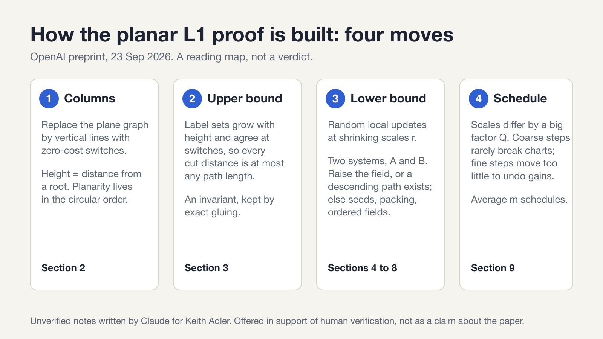

# Companion notes on *Planar Graph Metrics Embed into $L_1$ with Constant Distortion*

Section-by-section notes on the OpenAI preprint of 23 September 2026 ([PDF](https://github.com/openai/math/blob/main/preprints/Planar-Graph-Metrics-Embed-into-L1-with-Constant-Distortion-September-23-2026/paper.pdf)), written to support **a human reader's own verification**. They were prompted by Hung Le's public reading log ([*Rambling on Graphs*, "OpenAI Math Dump Hits My Home"](https://minorfree.github.io/OpenAIDump/), 7–11 October 2026).

## Standing of these notes

* **Unverified.** Written by Claude (an AI) for Keith Adler from a close reading of the PDF. No domain expert has checked them. Every item below carries one of three status tags:
  * **[stated]**: as stated or proved in the paper; reproduced here, not independently checked;
  * **[hand]**: a computation re-derived by the note's author;
  * **[Lean]**: machine-checked in Lean 4 / Mathlib, *under the hypotheses listed*. The Lean sources are being prepared for publication and are **not yet in a public repository**; until they are, treat a [Lean] tag as the author's report (status and exact scope in [12](docs/12-lean-status.md)). A Lean check establishes that a *formalised statement* follows from *stated hypotheses*; it does not establish that those hypotheses or that statement are the paper's.
* **No verdict on the main theorem is given or implied.**
* Keith Adler is not certain these notes help. They are offered because they may save a reader time on a single lemma; they are not a substitute for reading the paper.
* Numbering (Definition, Lemma, Proposition, equation) is the paper's own. The paper is 45 pages.

## The result

> **Theorem 1.1 (paper).** There is a universal constant $C\ge 1$ such that for every finite connected planar graph $G=(V,E)$ with positive edge lengths there are a measure space $(\Omega,\mathcal F,\mu)$ and $f:V\to L_1(\Omega,\mathcal F,\mu;\mathbb R)$ with
> $$d_G(x,y)\le \|f(x)-f(y)\|_1\le C\,d_G(x,y)\qquad(x,y\in V).$$

The paper states that this is the planar case of the conjecture of Gupta, Newman, Rabinovich and Sinclair, and that it gives a uniform bound on the undirected fractional flow–cut gap for planar graphs (via their equivalence). The paper does **not** claim closure under clique-sums, hence not the full conjecture. These notes take no position on whether the theorem is correct.

## Contents

| Note | Paper | Subject |
|---|---|---|
| [00 map](docs/00-map.md) | all | Architecture, dependency graph, and the correspondence with the reading log |
| [01 columns and bands](docs/01-columns-and-bands.md) | §2 | Column models, the circular order, portals, radial cells |
| [02 charts](docs/02-charts.md) | §3 | Threshold sets $\{Z<h+\sigma\kappa P\}$, charts, exact gluing, component refinement |
| [03 interpolation](docs/03-interpolation.md) | §4 | Theorem 4.1 and Corollary 4.6 |
| [04 scales and steps](docs/04-scales-and-steps.md) | §5 | Constant hierarchy, schedules, the step |
| [05 the main update](docs/05-main-update.md) | §6.1–6.2 | Raise-or-descend, low-tip certificates, seeds |
| [06 packing](docs/06-packing.md) | §6.3 | Proposition 6.6 |
| [07 ordered fields](docs/07-ordered-fields.md) | §7 | Ordered fields, transverse coordinate, two arcs |
| *(in progress)* 08 secondary update | §8 | Clipping near admitted seeds; ordered increments |
| *(in progress)* 09 assembly | §9–10 | One-step estimates, chart persistence, the schedule, the constant |
| *(in progress)* 10 where to look | all | Load-bearing steps and precise questions |
| *(in progress)* 11 glossary | all | Symbols and parameters |
| *(in progress)* 12 Lean status | §3 | What is machine-checked, with hypotheses |

Notes marked *(in progress)* are being written and are added as they are finished.

## Licence

Copyright 2026 Keith Adler. Licensed under the [Apache License, Version 2.0](LICENSE), the licence Mathlib uses, so the notes and any Lean material can be combined with it freely. The paper itself is OpenAI's; these notes paraphrase it and quote only short formulas. Corrections are welcome as issues or pull requests.
